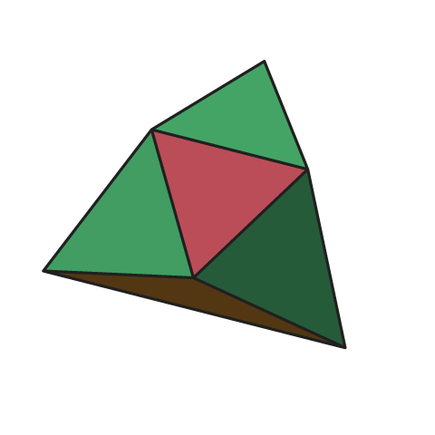

# Noperts

This is a collection of formalized results about Noperts. 

A shape is said to be Rupert if it's possible to pass an exact copy of
the shape through itself. It's named after Prince Rupert's Cube, the
first famous demonstration that the cube can do this. Surprisingly,
most convex polyhedra are Rupert, and it was not known whether any
counterexamples even existed until 2025. We call a polyhedron that
is not Rupert a "Nopert," for Nope + Rupert.

You can learn more about Ruperts and Noperts in my 2025 SIGBOVIK
paper [*Some upsetting things about shapes (that we already knew)*](https://tom7.org/ruperts/ruperts.pdf) or the later YouTube video [Rupert's Snub Cube and other Math Holes](https://youtu.be/QH4MviUE0_s), or if you want a more
serious account, on [Wikipedia](https://en.wikipedia.org/wiki/Prince_Rupert%27s_cube).

The results in this repository:
* A Lean verification that the following classic solids are Nopert:
  * [Snub Dodecahedron](snub-dodecahedron.md) (Archimedean solid)
  * [Pentagonal Hexecontahedron](pentagonal-hexecontahedron.md) (Catalan; dual of the SD)
  * [Deltoidal Hexecontahedron](deltoidal-hexecontahedron.md) (Catalan)

Elsewhere there are claimed proofs or verifications that the rhombicosidodecahedron<sup>[[1]](https://github.com/oscardssmith/Nopert.jl), [[2]](https://github.com/bence-hervay/nopert-rid)</sup> and snub cube are Nopert, so this classifies all of the Platonic, Archimedean, and Catalan solids.

* A Lean verification that my nopert candidate #231 is indeed a Nopert. This looks identical to the solid I showed in my video (#214) and conjectured to be Nopert, but fixes the problem that [#214 is actually Rupert](https://youtu.be/XFeKRSN9l9w)!
* The description and verification of the <b>Septopert</b>, a new 7-vertex Nopert.
* A Lean proof (kernel-only) that this is minimal; every convex polyhedron with six or fewer vertices is Rupert.

The nopert verifications involve a huge case analysis. So when I say "verification," I mean a proof that depends on external data files. We prove a proper theorem (Lean kernel-only) that says roughly "if this program validates the certificates, then the shape is not Rupert," and we run the program to see that it does in fact validate the certificates. This means trusting more than a kernel-only proof (akin to a proof that uses native_decide); the Lean compiler and runtime need to be correct as well. The certificates are found by [C++ code](search/), which need not be trusted. The certificates are also too big (many gigabytes) to include, so to reproduce the result you need to rebuild them using the [scripts](BUILDING.md).

## The Septopert



This is the Septopert, a minimal Nopert by vertex count (seven). 
Here they are:

```
(-940638,   327651,   327651)
( 327651,  -940638,   327651)
( 327651,   327651,  -940638)
( 703968,    47788,    47788)
(  47788,   703968,    47788)
(  47788,    47788,   703968)
(-514207,  -514207,  -514207)
```

It has three-fold symmetry, so you see the same numbers over and over.

In the proof (`proof/Septopert.lean`) we divide everything by 2^20
(1048576) so that the radius of the solid is close to 1, which you
might want to do too, unless you want a REALLY BIG nopert. Rupertness
is invariant of scale and rigid transformations, of course.

- All of the values fit in 32-bit floats, so the vertices in the
  [STL file](septopert.stl) are exact!
- Symmetry: C3v, with the 3-fold axis along (1,1,1). Vertices 0–2 are the
  permutations of (a, b, b), and vertices 3–5 the permutations of (c, d, d).
  Vertex 6 is e·(1,1,1).
- Combinatorics: 10 triangular faces, vertex degrees 5,5,5 (0–2), 4,4,4
  (3–5) and 3 (vertex 6). It is a gyroelongated triangular pyramid: a
  triangular antiprism (0–5) with a pyramid (apex 6) on the larger face
  0-1-2.
- Viewed down the axis from the small face: a triforce. Triangle 3-4-5
  projects to within 3.5% of the medial triangle of 0-1-2, and vertex 6 is
  hidden behind the center.

## Minimality

TODO

## Prints Nopert

Here is [septopert.stl](septopert.stl), a model you could 3D print.

## Credits and brief history

This work builds heavily on the [Noperthedron formalization](https://github.com/jcreedcmu/Noperthedron) by Jason Reed, David Renshaw, and others. That is a formalization of Jakob Steininger and Sergey Yurkevich's paper [*A convex polyhedron without Rupert's property*](https://arxiv.org/abs/2508.18475) ("SY25") which introduces the Noperthedron and its original verification.

AI: Embarrassingly much AI is involved here. David did the initial attempt at proving my "Candidate 214" (as well as some other unsolved solids). This required extending the mathematics to deal with non–point-symmetric solids, among other things. He used Sol 5.6 and Fable 5.0 for that. But he actually ended up discovering that my #214 [is Rupert](https://youtu.be/XFeKRSN9l9w). I picked it up from there with the goal of repairing #214 to redeem myself. Using Antigravity (Gemini 3.7 and 3.8 Flash) and Claude Code (Opus 5.5) I verified a repaired, identical-looking shape #231. This proof was not easy, and does use ideas from my [original attempt at proving the snub cube the first Nopert](https://youtu.be/QH4MviUE0_s) but you can tell how much of it is actually AI by the fact that I completed it while vacationing in Greece! It was briefly the smallest proven Nopert with 20 vertices and 27 faces.

Meanwhile we learned that earlier this year, Tony Zeng [proposed](https://arxiv.org/pdf/2604.26531) a much smaller solid (8 vertices) as a candidate Nopert. David was able to [verify it](https://github.com/dwrensha/StellatedTetrahedron/tree/main) in Lean using the improved machinery. 

This stood as the smallest proven Nopert for about one day. I had been simultaneously racing to verify a 7-vertex shape, the Septopert described above, that I found with computer search using my adversarial solvers. It is only just barely Nopert, so the proof requires a large certificate (7 gigabytes of packed data). I verified that on Oct 9, taking about 4 hours on a 64-core behemoth.

The natural question is then: Can we find a six-vertex Nopert? Or maybe we could prove that every tetrahedron or pentahedron is Rupert? Starting from some ideas of Jason's from 2025 and I like to think some wise guidance from its academic advisor and taskmaster (me), Opus 5.5 was able to prove this in about a day (Lean kernel-only proof): All convex solids with six or fewer vertices are Rupert. That means that the Septopert is a minimal (by vertex count) Nopert.
