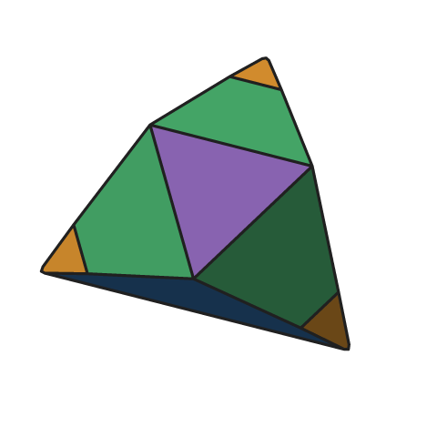
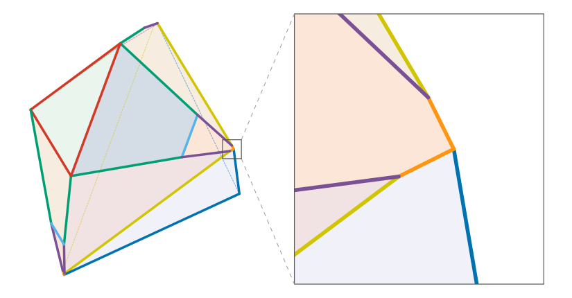

# Chipped M18
Tom 7, 8 Nov 2026

The Chipped M18 is a convex polyhedron that is not Rupert (a "nopert")
and has **acute dihedral angles**. It is [Septopert
M18](septopert-m18.md) with three of its corners chipped off, the way
a glass one would break if you dropped it on the ground and it bounced
exactly just right so that the corners broke symetrically. It answers
a question that came up in the [minimality](minimality.md) work: Every
nopert we knew had only obtuse or right dihedral angles, and we had
conjectured that an acute edge always yields a Rupert passage. The
Chipped M18 is a counterexample to that conjecture, a nopert with
acute dihedral angles.

Lean entry point: [`proof/ChippedM18.lean`](proof/ChippedM18.lean).

## The solid



Here is an exact [STL file](chipped-m18.stl) (in the integer coordinates
below).

Start with Septopert M18, whose vertices are (−18, 9, 9), (17, 3, 3),
(−9, −9, −9) and their coordinate permutations, scaled by 1/32. Cut
off the vertex (−18, 9, 9)/32 with the half-space (−1, 5, 5)·x ≤
209/64, and its two images under the 3-fold rotation about (1,1,1)
with the rotated half-spaces. Each cut removes a small corner (the new
acute edges are about 1/60 as long as M18's base edges) and leaves a
small pentagonal face. The three cut planes are images of each other,
and each lies symmetrically about a mirror plane of M18, so the
Chipped M18 keeps M18's full C3v symmetry.

It has 19 vertices and 13 faces (three new pentagons). Over a common
denominator of 4224 its vertices are integers:

```
(−2354,  1144,  1144)  and its 3 coordinate permutations   (a chip vertex)
(−2299,  1111,  1188)  and all 6 permutations              (chip vertices)
(−1494,   936,  1524)  and all 6 permutations              (chip vertices)
(  396,   396,  2244)  and its 3 coordinate permutations   (M18's (3,3,17)/32)
(−1188, −1188, −1188)                                      (the apex, M18's (−9,−9,−9)/32)
```

The Lean statement (`chippedM18`) uses these divided by 4224. Any scale
or rigid transformation of the solid is a nopert too.

### Edge info

Computed in exact arithmetic from the Lean vertices. Lengths are in the
Lean coordinates (the integers above divided by 4224).



Schematic. The chip is a small feature repeated three times; the
right panel zooms in on one of them. Each edge of the same color
is equal.

| color | description | edges | dihedral angle | edge length |
|-------|-------------|-------|----------------|-------------|
|| **acute**: chip pentagon against a pyramid face | 0–1, 0–2, 10–12, 11–13, 12–14, 13–15 | **81.950533°** (cos = 1/√51) | 0.018414 |
|| apex of pyramid | 0–5, 5–12, 5–13 | 90° (exactly) | 0.828125 (= 53/64) |
|| triforce exterior (shortened) | 3–6, 6–8, 4–7, 7–9, 16–18, 17–18 | 106.945562° | 0.495584 |
|| chip pentagon, new edge | 1–3, 2–4, 8–10, 9–11, 14–16, 15–17 | 108.691736° | 0.210627 |
|| triforce center | 6–7, 6–18, 7–18 | 140.882929° | 0.618718 |
|| base of pyramid (shortened) | 1–10, 2–11, 14–15 | 146.496544° | 1.141683 |
|| chip pentagon, new edge | 3–4, 8–16, 9–17 | 175.803214° | 0.196865 |

The chips leave M18's face planes where they were, so the surviving
edge classes keep exactly M18's dihedral angles (including the right
angles at the apex). Every edge except the three triforce-center edges
now ends at a chip. The six acute edges are the short edges where a chip
pentagon meets the two pyramid faces at the chipped vertex.

## The statement

In [`proof/ChippedM18.lean`](proof/ChippedM18.lean):

```lean
theorem isNopert_of_certificatesValid (h : CertificatesValid) : IsNopert chippedM18
```

`IsNopert`, `IsRupert` and the trust model are as for the
[Septopert](septopert.md#what-is-proved-and-what-is-verified): the
theorem is checked by Lean's kernel and depends only on the standard
axioms (`propext`, `Classical.choice`, `Quot.sound`), and the program
`constructChippedM18` checks the certificate data with the same Lean
validity checks as compiled code before constructing `IsNopert
chippedM18`.

## How the proof works

The Chipped M18 keeps M18's symmetry, so it reuses M18's pipeline and
Lean development almost unchanged ([How the Nopert proofs
work](nopert-proof.md)): the exact rational model and view cover (21
view codes and 32 code triangles, against M18's 15 and 22), the
identity tube with [identity blow-up
rows](nopert-proof.md#identity-blow-up-certificates), the
[cap](nopert-proof.md#caps) at the mirror normal, the [arc
cap](nopert-proof.md#arc-caps) along the cube-corner arc ending at U =
(2,2,−1)/3, and the [5D search](nopert-proof.md#the-5d-search).

Keeping the symmetry was the point. Chipping a single vertex of a
nopert, which is the obvious way to make an acute edge, breaks its
symmetry, and every broken symmetry becomes a family of near-ties that
needs its own special certificates. A nopert whose vertex is fixed by a
mirror (as M18's base vertices are) can instead be cut by a plane that
lies symmetrically about that mirror and still be acute, and cutting
the whole orbit of that vertex keeps the full symmetry group.

The depth of the cut matters. A much deeper cut with normal (−1, 4, 4)
(depth 1/4) is Rupert: there is an exact passage near the identity,
with rotation angle 0.034 and clearance 5·10⁻⁶. At the depth used here,
the chip actually removes M18's arc of views with zero first-order
margin (leaving only isolated zeros at U and the mirror normals), and
lowers the margin elsewhere only slightly. Cuts with normals (−1, k, k)
for k between about 2.5 and 6 all look similar (a floating-point study,
not part of the proof); k = 5 at depth 7/64 was the one carried through.

## Status

Verified on 2026-11-08: `constructChippedM18` (then
`constructChipM18K5`) checked the mirror cap certificate (132 charts),
the arc cap certificate (146 charts, 15,083 leaves), the tube tables
(55,112 rows), and the four chart tables (3,782,781, 180,616, 156,972
and 129,051 rows), and printed `instantiated: IsNopert chippedM18 (the
Chipped M18 is a Nopert: not Rupert)`. Verification took 28 minutes on
36 threads.

To reproduce it from scratch:

```sh
./get-cc-lib.sh
(cd proof && lake exe cache get)    # Mathlib build cache
search/chipped-m18/rebuild.sh       # all stages; WORK=DIR and TH=N to override the work dir and thread count
```

(A clean reproduction of the certificates is in progress; its stage times will go here.)

## The data

The certificate data is machine output, intended to be CC0 (but not
hosted here):

- `arc.cert`: 683 KB, the arc cap certificate (146 charts);
- `cap-1_16.cert`: 478 KB, the cap certificate around the mirror directions;
- `tube_packs/`: 16 MB, the identity-tube tables and `manifest.txt`;
- `packs/`: 243 MB, solution packs for the 4 charts and 32 code triangles.
