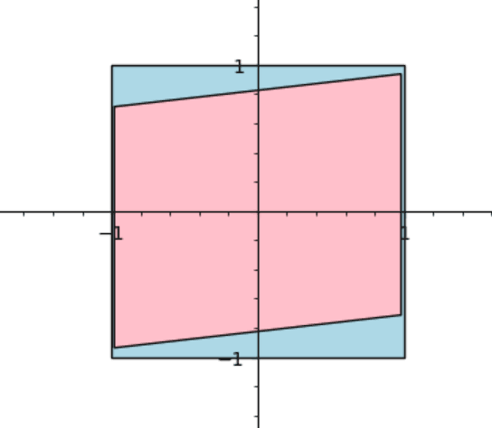

# Minimality: Every nopert has at least 7 vertices

Every convex polyhedron with 6 or fewer vertices is Rupert, and the
[Septopert](septopert.md) is a Nopert witness with 7 vertices. So we
achieve a tight bound: 7 is the smallest number of vertices for any
Nopert.

The minimality theorem is a **Lean proof**: every step is checked by
Lean's kernel and it depends only on the standard axioms (`propext`,
`Classical.choice`, `Quot.sound`).

Lean entry point: [`proof/Minimality.lean`](proof/Minimality.lean).

## The statement

```lean
/-- A nopert: a finite set of points that do not all lie in one plane (so
their convex hull is a genuine solid) and whose convex hull is not Rupert. -/
def IsNopert (V : Finset ℝ³) : Prop := ¬ Coplanar ℝ (V : Set ℝ³) ∧ ¬ IsRupert V

/-- Every nopert has at least 7 points. -/
theorem seven_le_card_of_isNopert (V : Finset ℝ³) (h : IsNopert V) : 7 ≤ V.card
```

`IsRupert` (in `proof/MainTheorem.lean`) is the same definition used for the
Septopert. `V` is a finite set of points; the solid is its convex hull. (In
this formalization, the points do not need to be the vertices. But this
also of course bounds the number of vertices.)

The same file also states sharper facts about point sets, including flat ones
(the Rupert property only looks at shadows, so a flat polygon can pass
through a copy of itself):

- every set of 6 or fewer points whose hull is a solid is Rupert
  (`isRupert_of_card_le_six`);
- every set of points that lies in a plane but not on a line is Rupert, for
  any number of points (`isRupert_of_coplanar_of_not_collinear`);
- a nonempty set of points on a line is never Rupert
  (`not_isRupert_of_collinear`);
- so for 6 or fewer points: Rupert ⟺ empty, or not all on one line
  (`isRupert_iff_of_card_le_six`);
- a nopert with exactly 7 points has no face containing 5 or more of them,
  so its faces are triangles and quadrilaterals
  (`facet_card_le_four_of_isNopert`, from `isRupert_of_card_seven_of_facet`).
- a nopert with exactly 7 points in general position (no two segments
  between its points parallel or orthogonal) has at most three
  quadrilateral faces (`not_four_quad_facets_of_isNopert`): four
  quadrilateral faces force one face structure, which is Rupert by a
  slightly tilted view along the edge where two of the quadrilaterals meet.
- a nopert with exactly 7 points in general position has no two
  quadrilateral faces that meet in a single point
  (`not_two_quad_facets_vertex_of_isNopert`): Viewed along the line where
  the planes of the two faces cross, the shadow is a triangle, and a
  slightly tilted view has a silhouette with one deepest and one
  shallowest point, which gives a passage. (This also needs general
  position at that line: no segment parallel to it, distinct depths along
  it.)
- more generally, in a nopert in general position, two faces of any size
  that meet in a single point never leave all the other points strictly
  inside the triangle shadow of that view
  (`not_facets_vertex_triShadow_of_isNopert`): The triangle has a corner at
  the shared point and one at the far end of each face, and the same tilted
  view gives a passage. The same holds for two faces that share an edge,
  viewed along that edge (`not_facets_edge_triShadow_of_isNopert`).
- a nopert in general position is not a capped triangular frustum (three
  quadrilateral sides, a triangular base, a three-sided cap; type 10 of the
  notes) (`not_type10_of_isNopert`): One of two such views always works, and
  a single number built from the face planes says which. The same
  argument excludes type 19 (two quadrilaterals sharing an edge, six
  triangles; `not_type19_of_isNopert`) and type 13 (another such
  arrangement; `not_type13_of_isNopert`) and type 17
  (`not_type17_of_isNopert`), and type 27 (one quadrilateral, eight
  triangles; three views; `not_type27_of_isNopert`) and type 23
  (`not_type23_of_isNopert`), type 25 (`not_type25_of_isNopert`) and
  type 26 (`not_type26_of_isNopert`), and type 12 (two quadrilaterals
  sharing an edge, a cone from one vertex over them;
  `not_type12_of_isNopert`), type 22 (`not_type22_of_isNopert`) and
  type 28 (`not_type28_of_isNopert`), and type 05 (three quadrilaterals;
  `not_type05_of_isNopert`). So every face structure on seven points that
  the notes prove Rupert (24 of the 29 non-simplicial ones) is now excluded
  in Lean, in general position.

## How it is proved

The proof finds an explicit passage for every possible solid. Each
passage is "near the identity": The inner copy is rotated by a tiny
amount relative to the outer one, viewed from a carefully chosen
direction. The core idea comes from discussions that David and Jason
and I had during my [2025 attempt](https://youtu.be/QH4MviUE0_s) to
prove the snub cube Nopert. Jason noticed that when you view a
paper-thin square face-on, there are Rupert passages arbitrarily close
to the identity. Historic SageMath alert:



Roughly: When the 2D hull is a convex polygon, all of whose
vertices are in the same 3D plane, then such a Rupert passage exists.
(For example, as part of the proof development I posed the challenge
problem to Opus 5.5 to prove that every bipyramid with its waist
sitting on the XY plane has a local passage arbitrarily close to the Z
axis. The waist always forms such a planar hull.) Moreover this can be
generalized (see below) to hull vertices whose depth doesn't zig-zag
too much.

For tetrahedra, we can always look directly at one of the faces from the
remaining vertex, so that it is in the hull. Then we just use the
lemma above. Case analysis works for 5 vertices, and some more fancy
machinery closes 6.

A bit more detail:

1. **First order suffices.** If, at some view, a small rotation and
   translation of the inner copy moves every corner of its shadow strictly
   into the outer shadow, then for a small enough rotation the inner shadow
   lies strictly inside. This is a Rupert passage.
2. **Planar silhouettes.** If, at some oblique view, the corners of the
   shadow all come from vertices lying in one plane, such a motion exists,
   unless the view's level direction happens to be a "double normal" of the
   shadow, which only happens on finitely many great circles of views.
3. **Unimodal silhouettes.** More generally, it suffices that the depth of
   the shadow's corners, walking around the outline, rises once and falls
   once. The proof goes through the balancing forces at the corners.
4. **Tilting off degenerate views.** Views where an edge or face is seen
   exactly edge-on can be tilted slightly to produce a unimodal view with a
   chosen outline.
5. **The cases.** Up to 5 vertices: a pyramid, or (by Radon's theorem) a
   segment piercing a triangle, i.e. a bipyramid. With 6 vertices, the
   points' affine dependencies (a "Gale diagram") either show the solid is a
   prism, or give a segment piercing a quadrilateral; in the latter case the
   signs of a few determinants determine the solid's faces, and each of the
   seven combinatorial types of 6-vertex polyhedra (octahedra, bicapped
   tetrahedra, triangular prisms, pentagonal pyramids, and three others) has
   its own argument built from 1–4. Octahedra are the hardest case.
6. **Seven points with a large face.** If 6 of the 7 points lie on a face,
   the solid is a pyramid. If 5 do, look along the face's plane, so that the
   face is seen edge-on, and tilt (4). When the other two points are at
   different heights below the face, a view in the face's plane hides the
   higher one, and the tilted outline (the face's lower boundary, then the
   lower point) is unimodal from one of the two opposite sides. At equal
   heights, look along the segment joining them: tilting hides one behind
   the other, and if the outline is still not unimodal from either end, a
   planar silhouette (2) exists with the face as the plane.

No classification of polyhedra by face structure is assumed; everything is
derived from the coordinates.
