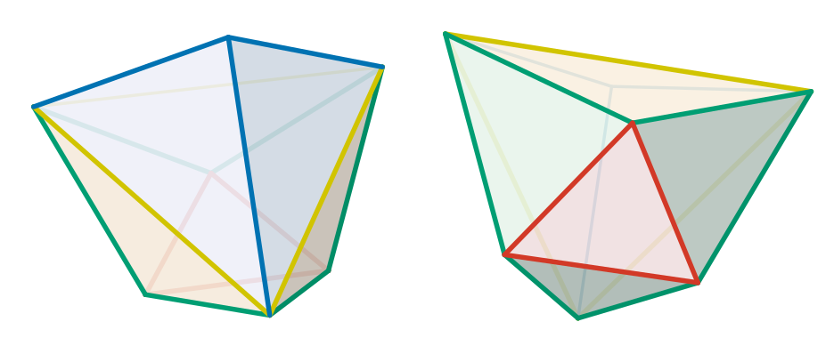

# The Septopert
Tom 7, 10 Oct 2026

The Septopert is a new convex polyhedron with 7 vertices that is not Rupert.
Since 7 is the [fewest possible vertices](minimality.md), this is the
smallest possible Nopert.
This page gives the exact statement, what Lean checked and how, and how to
reproduce the result.

Lean entry point: [`proof/Septopert.lean`](proof/Septopert.lean).

## The solid


Here is an exact [STL file](septopert.stl). On github, you can
rotate it around in your browser by just clicking on that.

The solid is the convex hull of these points (its vertices):

```
(-940638,   327651,   327651)
( 327651,  -940638,   327651)
( 327651,   327651,  -940638)
( 703968,    47788,    47788)
(  47788,   703968,    47788)
(  47788,    47788,   703968)
(-514207,  -514207,  -514207)
```

The proof divides by 2^20 so that the maximum magnitude is about 1.
In lowest terms (the form used in Lean, `septopert` in
`proof/Septopert.lean`):

| vertex | x | y | z |
|---|---|---|---|
| 0 | −470319/524288 | 327651/1048576 | 327651/1048576 |
| 1 | 327651/1048576 | −470319/524288 | 327651/1048576 |
| 2 | 327651/1048576 | 327651/1048576 | −470319/524288 |
| 3 | 21999/32768 | 11947/262144 | 11947/262144 |
| 4 | 11947/262144 | 21999/32768 | 11947/262144 |
| 5 | 11947/262144 | 11947/262144 | 21999/32768 |
| 6 | −514207/1048576 | −514207/1048576 | −514207/1048576 |

- The statement is about these points (largest |v| ≈ 0.99999935).
  The integer form is the same solid scaled by 2^20. Any scale or
  rigid transformation of the solid is a Nopert.
- Symmetry C3v: a 3-fold axis along (1,1,1) and three mirror planes (each
  swapping two coordinates). Vertices 0–2 are the permutations of (a, b, b),
  vertices 3–5 those of (c, d, d), and vertex 6 is e·(1,1,1).
- 10 triangular faces; vertex degrees 5,5,5 (vertices 0–2), 4,4,4 (3–5)
  and 3 (vertex 6). Combinatorially a gyroelongated triangular pyramid: a
  triangular antiprism (vertices 0–5) with a pyramid (apex 6) on its larger
  face.
- `search/septopert/septopert-model.txt` is the exact (rational) model the
  search uses; `proof/Septopert/ModelData.lean` has the same vertices.

### Edge info



| color | description | dihedral angle | relative edge length
|-------|-------------|----------------|-----------------------------
|| apex of pyramid | 90.333818° | 1.206047
|| base of pyramid | 146.145261° | 1.710540
|| triforce exterior | 107.080553° | 1.043358
|| triforce center | 140.788349° |0.884989

## The statement

In [`proof/Septopert.lean`](proof/Septopert.lean):

```lean
theorem isNopert_of_certificatesValid (h : CertificatesValid) : IsNopert septopert
```

`IsNopert V` (in `proof/Nopert.lean`) says that the points of `V` are not all
in one plane, so their convex hull is a genuine solid, and that this solid is
not Rupert. `IsRupert` (in `proof/MainTheorem.lean`) is the Rupert property:
Two copies of the solid, each rotated, can be placed so that the shadow of
one lies strictly inside the shadow of the other. `CertificatesValid` says
that the certificate data (four solution tables and a cap certificate) passes
Lean's validity checks. The same `IsNopert` is used by the
[minimality](minimality.md) result, so the [two together](proof/ProofOfMainTheorem.lean) say that the vertex count of the smallest possible nopert is exactly 7.

## What is proved and what is verified

This is a **Lean verification**, not a direct kernel-only Lean proof:

1. **Lean proof.** `isNopert_of_certificatesValid` is checked by Lean's
   kernel and depends only on the standard axioms (`propext`,
   `Classical.choice`, `Quot.sound`). Its "genuine solid" half needs no data
   at all.
2. **Verification of the data.** The data is about 850,000 table rows
   (45 MB), too much for the kernel. The program `constructSeptopert` runs
   the same Lean validity checks as compiled code on every row, and only if
   all pass does it construct `IsNopert septopert` (via part 1) and print
   `instantiated: IsNopert septopert (the Septopert is a Nopert: not Rupert)`.
   This step trusts Lean's compiler and runtime to evaluate the checks
   correctly. This is the same trust as `native_decide`, though `native_decide` is
   not used.

The C++ search in `search/septopert/` that produced the data does not
need to be trusted: A mistake there can only produce data that fails
the checks. That said, the C++ does its own independent checks of the
certificate conditions as it searchs for them and prepares them for
Lean. It would be very unlikely that a bug in the Lean
compiler/runtime would also occur in the C++ search (perhaps something
like a bug in GMP's integer multiplication routines.)

Additionally, I ran my GPU solver for 60 billion iterations on the Septopert,
which searches for Rupert passages via a completely different method.
This is not part of the proof at all, but it provides additional comfort
that we didn't just get hypnotized by the AI or miss something silly in the
proof statement.

We also need to trust that the proof statement itself matches the
pre-formal idea of what we mean by "Rupert" and "Nopert". I use the
same [definition](proof/MainTheorem.lean) from the Noperthedron
project. It is not very mysterious:

```lean
def IsRupert (vertices : Finset (EuclideanSpace ℝ (Fin 3))) : Prop :=
   ∃ inner_rotation ∈ Matrix.specialOrthogonalGroup (Fin 3) ℝ,
   ∃ inner_offset : EuclideanSpace ℝ (Fin 2),
   ∃ outer_rotation ∈ Matrix.specialOrthogonalGroup (Fin 3) ℝ,
   let hull := convexHull ℝ vertices
   let inner_shadow := { inner_offset + proj_xy (inner_rotation.toEuclideanLin p) | p ∈ hull }
   let outer_shadow := { proj_xy (outer_rotation.toEuclideanLin p) | p ∈ hull }
   inner_shadow ⊆ interior outer_shadow
```

A set of points (note: not a solid) is Rupert if there exists
rotations for the inner and outer copies (`specialOrthogonalGroup`
just means 3D rotation), and a 2D translation of the inner copy, such
that the inner shadow is contained in the interior of the outer
shadow. The shadows are just the 2D projections of the 3D convex
hulls. This is almost identical to how I describe it to people on
the whiteboard.

That said: There is certainly subtlety to be wary of! For example,
I could have presented you a proof like this:

```lean
noncomputable def CoolShape : Finset ℝ³ := { ... vertices ... }

theorem CoolShapeIsNotRupert : ¬ IsRupert CoolShape := by ...
```

And claimed that this `CoolShape` is a Nopert (not Rupert) with some
enormous meandering proof. But `¬ IsRupert` is also easily satisfied
by degenerate vertices! For example, if all the vertices are
collinear, then the convex hull is just a line, and its interior is
empty, so we can never have `line ⊆ ∅`. Our
[definition](proof/Nopert.lean) of `IsNopert` adds a condition that
the point set gives a genuine solid 
(`¬ Coplanar ℝ (V : Set ℝ³) ∧ ¬ IsRupert V`).

## How the proof works

The techniques are described in [How the Nopert proofs work](nopert-proof.md);
for the Septopert:

- The vertices are rational, so the tables are checked against the exact
  solid ([rational models](nopert-proof.md#rational-models-and-neighborhoods)).
- Views are reduced into the C3v view domain (two triangles, covered by the
  [code triangles](nopert-proof.md#codes-and-the-view-cover)), relative
  rotations into the C3v cell, using the C3 prune and the
  [mirror-tie reduction](nopert-proof.md#poses-and-symmetry-reductions)
  (`Septopert/CellPrune.lean`, `Septopert/MirrorTie.lean`).
- Near its mirror normal x = (1, 0, −1) a mirror tie approaches the identity,
  so a [cap](nopert-proof.md#caps) covers those poses
  (`capcert-septopert`, `Septopert/Caps.lean`).
- The Septopert is only just barely Nopert: in one strip of views its
  first-order margin is about 3·10⁻⁴. So nearly all of its
  [identity tube](nopert-proof.md#the-identity-tube) is replaced by
  [identity blow-up rows](nopert-proof.md#identity-blow-up-certificates),
  each ruling out every rotation within 1/64 of the identity over its view
  triangle; the [5D search](nopert-proof.md#the-5d-search) covers the rest.
- Near a view where two faces are edge-on at once, the best inner vertex
  switches inside boxes; [blended inner points](nopert-proof.md#balanced-witnesses)
  certify them.

## Status

Verified on 2026-10-15 on a 64-core machine: `constructSeptopert` checked
the cap certificate, the 22 tube tables (250 rows, 176 of them identity
blow-up rows) and the four chart tables (476,073, 143,787, 123,839 and
104,243 rows) and printed `instantiated: IsNopert septopert (the Septopert
is a Nopert: not Rupert)`. You can reproduce it yourself, following the
instructions in [BUILDING.md](BUILDING.md):

```sh
./get-cc-lib.sh
(cd proof && lake exe cache get)    # Mathlib build cache
search/septopert/rebuild.sh --from model --threads 64
```

Note that the certificate search is not deterministic since it runs on
multiple cores and tests a cache of recent certificates that can be reused
for nearby cells. So you may not get the same row counts, etc. as I did.

This builds everything, runs `codebdd` on the exact model
`search/septopert/septopert-model.txt` (and regenerates the view cover
`proof/Septopert/ViewCoverData.lean` from its output), builds the identity
tube and replaces nearly all of it by identity blow-up rows, runs the search,
packs the tables into `work/`, and finally runs `constructSeptopert` on
them. Stages: `model`, `tube`, `idcap`, `tubepack`, `cap`, `search`, `pack`,
`verify`; `--from STAGE` restarts at a stage, `--only STAGE` runs one,
`--work DIR` moves the output. Each stage appends its wall time to
`work/stages.log` (and prints its peak memory); the Lean build runs in the
background while the C++ stages run (log `work/lean_build.log`).

Measured times of a from-scratch run on 64 cores with 64 threads
(2026-10-15; the model stage on 2026-10-14), about 21 min in all:

| Stage | Time |
|---|---|
| model | 9 s |
| tube + tubepack | 3.5 min |
| idcap | 11.4 min |
| cap | 36 s |
| search | 1.5 min (354,845 nodes) |
| pack | 45 s |
| verify | 3.4 min, 744 MiB peak |

### History

I first verified the Septopert on October 9, 2026. I reproduced it two
times on two different computers (October 9 and 10), and independently
from a fresh clone in a sandbox. This first version of the proof used
the "identity tube" to rule out local passages. Its data was enormous
at about 85 million rows (6.7 GB), taking 3 hours and 15 GB of RAM on
64 cores; see the [historic revision](https://github.com/tom7/noperts/blob/8a8ea2ab/septopert.md).

A new version developed a few days later uses "blow-up" certificates,
which cuts the size by about 50x, although each certificate is more
expensive to verify. An end-to-end reproduction takes about 80 minutes
on a 64-core beefcake.

## Verifying existing data

Given the data (`tube_packs/`, `packs/`, `cap-1_16.cert`), only the last
stage is needed:

```sh
(cd proof && lake build constructSeptopert)
cd work && LEAN_NUM_THREADS=64 ../proof/.lake/build/bin/constructSeptopert \
  tube_packs/manifest.txt packs cap-1_16.cert
```

It checks the cap certificate, the 22 tube tables, then the four chart
tables one at a time. Chart 0 has about 480,000 rows; charts 1–3 have
less than 150,000 rows each.

## The data

The certificate data is machine output, intended to be CC0:

- `cap-1_16.cert`: 550 KB, the cap certificate around the mirror directions;
- `tube_packs/`: 1.4 MB, 22 identity-tube tables and `manifest.txt`;
- `packs/`: 45 MB, 92 per-code solution packs (`packs/c<chart>/t<code>.pack`;
  the largest, `packs/c0/t2.pack`, is 2.9 MB).

All three together compress to about 8 MB (`tar czf`).

To check it yourself, rebuild it (see "Status" above).
