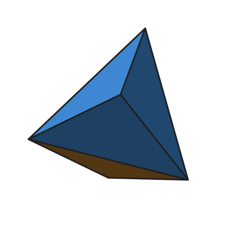
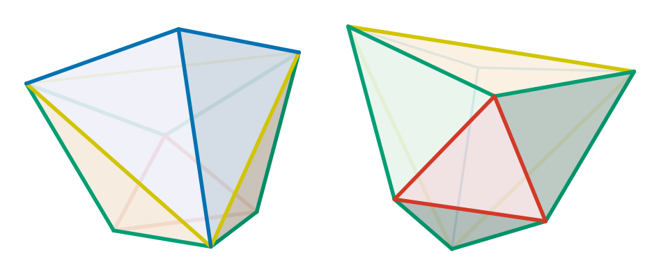

# The Septopert
Tom 7, 7 Nov 2026

The Septopert is a convex polyhedron with 7 vertices that is not
Rupert (a "nopert"). 7 vertices is the fewest possible for a nopert.
It is the third and smallest member of the Septopert family to be
proved: after the holotype [Septopert Classic](septopert-classic.md)
and [SeptopertM18](septopert-m18.md), with
[SeptopertM12](septopert-m12.md) alongside it. Its integer coordinates
are the smallest possible for a nopert in this family (see "Least
height" below). This page gives the exact statement, what Lean checked
and how, and how to reproduce the result.

Lean entry point: [`proof/Septopert.lean`](proof/Septopert.lean); the headline theorem is in
[`proof/Septopert/Integer.lean`](proof/Septopert/Integer.lean).

## The solid



Here is an exact [STL file](septopert.stl). On github, you can
rotate it around in your browser by just clicking on that.

The solid is the convex hull of these points (its vertices):

```
(-7,  7,  7)
( 7, -7,  7)
( 7,  7, -7)
( 3, -4, -4)
(-4,  3, -4)
(-4, -4,  3)
( 7,  7,  7)
```

It is a very 7 solid: 7 vertices, coordinates ±7 and 3, 4 (3 + 4 = 7),
apex edges of length 14, base edges 14√2 and inner triangle edges 7√2.

The Lean statement is about exactly these integer points (largest
|v| = √147 ≈ 12.12). Any scale or rigid transformation of the solid is a
Nopert too.

- Symmetry C3v, as for the other members: a 3-fold axis along (1,1,1)
  and three mirror planes. Vertices 0–2 are the permutations of
  (−7, 7, 7), vertices 3–5 those of (3, −4, −4), and vertex 6 is
  7·(1,1,1).
- 10 triangular faces, the same 10 as the rest of the family (vertex
  lists 015, 016, 024, 026, 045, 123, 126, 135, 234, 345); vertex
  degrees 5,5,5 (vertices 0–2), 4,4,4 (3–5) and 3 (vertex 6).
  Combinatorially a gyroelongated triangular pyramid.
- **Two special features** (both exact), which is what makes the proof
  harder:
  - *Cube corner.* The apex, vertex 6, is a cube corner, as for
    SeptopertM18: the edges 6–0, 6–1, 6–2 are mutually orthogonal, so
    the three apex dihedral angles are exactly 90°.
  - *Exact Triforce.* Seen along the 3-fold axis, vertex 3 lies exactly
    at −1/2 times vertex 0 (and so on), so the inner triangle 3–4–5
    projects onto the medial triangle of the base 0–1–2. Equivalently,
    the plane of face 0–2–4 contains the axis, and so face 0–2–4 is
    perpendicular to face 3–4–5. This is a second right angle, and it
    gives a second family of views at which the first order vanishes.

  SeptopertM12 is in the same double special position; SeptopertM18
  and Septopert Classic are not Triforces (Classic misses by about
  3.5%).

### Edge info

Exact arithmetic (integer face normals; lengths in the integer
coordinates above).



(Note: This is a schematic drawing used for any member of the Septopert family, not exact.)

| color | description | edges | dihedral angle | edge length |
|-------|-------------|-------|----------------|-------------|
|| apex of pyramid | 6–0, 6–1, 6–2 | 90° (exactly) | 14 |
|| base of pyramid | 0–1, 0–2, 1–2 | 144.735610° | 14√2 ≈ 19.798990 |
|| triforce exterior | 0–4, 0–5, 1–3, 1–5, 2–3, 2–4 | 108.316731° | √146 ≈ 12.083046 |
|| triforce center | 3–4, 3–5, 4–5 | 141.057559° | 7√2 ≈ 9.899495 |

## The statement

In [`proof/Septopert/Integer.lean`](proof/Septopert/Integer.lean):

```lean
theorem isNopert_intVerts (h : CertificatesValid) : IsNopert intVerts
```

`intVerts` is the set of the seven integer points above (`septopert` is
another name for it).

`IsNopert`, `IsRupert` and the trust model are as for
[SeptopertM18](septopert-m18.md#the-statement). `CertificatesValid`
says that the certificate data (four solution tables, the mirror cap
certificate, and three special caps: the arc cap, the axis cap and the
P cap) passes Lean's validity checks. The same `IsNopert` is used by the
[minimality](minimality.md) result, and the Septopert is the 7-vertex
witness in [`proof/ProofOfMainTheorem.lean`](proof/ProofOfMainTheorem.lean).

The certificates are built in a congruent copy of the solid (`verts`,
coordinates over 64: (−27,15,15), (27,6,6), (−13,−13,−13) and
permutations). A short bridge lemma maps it to the integer coordinates
with an exact similarity (scale 3/64, a reflection through the axis
composed with the 180° rotation about it, and a translation), and
similarities preserve Rupertness.

## What is proved and what is verified

As for SeptopertM18: `isNopert_intVerts` is checked by
Lean's kernel and depends only on the standard axioms (`propext`,
`Classical.choice`, `Quot.sound`). The data (about 732,000 table rows
and the cap certificates) is checked by the program
`constructSeptopert`, which runs the same Lean validity checks as
compiled code and only then constructs `IsNopert intVerts`, printing

```
instantiated: IsNopert Septopert.intVerts (CapOk, ArcOk, AxisOk, PCapOk checked natively; tube and chart tables checked)
```

## How the proof works

The technique is the one in [How the Nopert proofs work](nopert-proof.md),
with the [arc cap](nopert-proof.md#arc-caps) of SeptopertM18. The view
cover has 13 view codes and 16 view-code triangles (SeptopertM18: 15
and 22). The tube and the 5D search close everything except four small
regions of views, each of which needs a blow-up certificate because the
first-order margin vanishes there:

1. **The mirror cap** at the mirror normal, as for every member of the
   family.
2. **The cube-corner arc**, as for SeptopertM18: an arc of views ending
   at U, the view straight down an apex edge, where the face through
   that edge is edge-on and the right angle at the apex makes every
   first-order margin zero. It is certified by an arc cap (wedge charts
   along the arc plus a point cap at U).
3. **The axis view**, the view along the 3-fold axis. Here the Triforce
   makes the inner triangle's projection line up exactly with the base's
   medial triangle (an exact coincidence), and the first order again vanishes, at an isolated
   view. It is certified by a point cap around the axis (rotations
   within 1/46 in Cayley coordinates; tilt μ·(s₁, s₂), spin μ²·s₃).
4. **The face-024 strip.** Face 0–2–4 contains the axis, so there is a
   circle of views at which it is edge-on, and the first order vanishes
   along a stretch of that circle starting at a view P, with a
   2-dimensional cone of first-order flexes. It is certified by the
   P cap: a point cap at the end view P together with a wedge of polar
   charts along the strip.

In each case the decision moves to second order, where the clearance
is strictly negative, which is why a certificate exists (floating-point
and symbolic study, not part of the proof).

## Least height

Write a member of the family by its five coordinate values x = (x0, ..., x4):
the points (x0, x1, x1), (x2, x3, x3) and their permutations, and
(x4, x4, x4). Its **height** is half the range of those values, rounded up.
The Septopert's values are 7, −7, 3, −4, 7 (range 14), so its height is 7.
No integer member of lower height is a nopert. In
[`proof/SeptopertFamily.lean`](proof/SeptopertFamily.lean):

```lean
theorem not_isNopert_of_familyHeight_lt_seven (hvalid : LeastHeightValid) :
    ∀ x : Fin 5 → ℤ, familyHeight x < 7 → ¬ IsNopert (familyVerts x)
```

The statement covers every integer tuple, with any signs. Translating,
scaling and reflecting the tuple preserves being a nopert (proved in Lean),
so it reduces to 55,651 canonical tuples with values in [0, 12], each with a
small certificate checked by `checkSeptopertFamily` (about 4 seconds):

- 161 are coplanar (a plane through all 7 points);
- 25,932 have a point in the convex hull of the others (explicit convex
  weights), so at most 6 points span the hull and the
  [minimality](minimality.md) theorem applies;
- 29,558 have an exact Rupert passage: rotations from integer quaternions
  q (as R(q)/|q|²), a rational offset, and for each inner vertex an outer
  triangle that strictly contains its shadow.

The table is [`proof/SeptopertFamily/data/leastheight.txt`](proof/SeptopertFamily/data/leastheight.txt)
(2.7 MB). Like the other results, this is a kernel theorem (axioms
`propext`, `Classical.choice`, `Quot.sound`) plus a native check of the data.

## Status

Verified on 2026-11-07: `constructSeptopert` (then `constructM7`)
checked the mirror cap (52 charts), the arc cap (146 charts, 22,282
leaves), the axis cap (52 charts, 3,384 leaves), the P cap (78 charts,
43,869 leaves), the tube tables, and the four chart tables (406,726,
124,781, 108,449 and 92,514 rows), and printed the `instantiated` line
above. On 12 cores of a busy machine it took about 23 minutes (stage
times: mirror cap 196 s, arc cap 723 s, axis cap 16 s, P cap 300 s,
tables the rest).

TODO: reproduction from scratch with `search/septopert/rebuild.sh`.
The arc, axis and P cap certificates were made by scripts outside the
pipeline (capcert-m7 and leaf2cert.py); they need to be wired into
rebuild.sh before the reproduction.

## The data

The certificate data is machine output, intended to be CC0:

- `proof/Septopert/data/axis-cap.cert` (148 KB) and
  `proof/Septopert/data/pcap-wp.cert`, `pcap-u.cert` (349 KB and
  1.5 MB): the axis cap and the P cap, in the repository;
- `arc.cert`: 916 KB, the arc cap certificate (146 charts, 22,282 leaves);
- `cap-1_16.cert`: 408 KB, the mirror cap certificate;
- `tube_packs/`: 944 KB, 16 identity-tube tables and `manifest.txt`;
- `packs/`: 37 MB, 64 solution packs, one for each of the 4 charts and
  16 view-code triangles (about 732,000 rows).

The four not in the repository compress to about 6.8 MB (`tar czf`).
